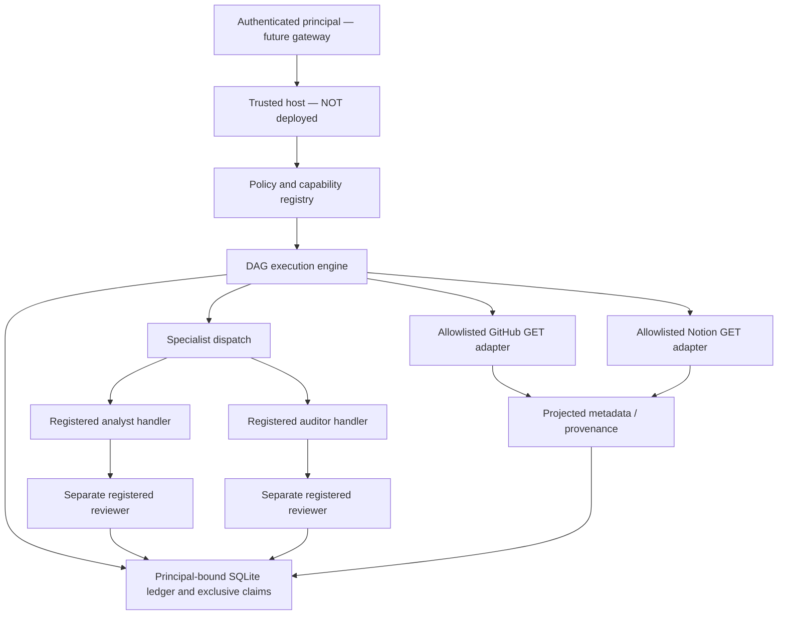

# UPAOI v0.3 architecture — governed local execution and specialist handoffs



**Implemented:** Python DAG runtime, fixed capability contracts, principal-bound request IDs, atomic SQLite exclusive claims, JSON-only specialist packet validation and registered reviewer handoffs, read-only GitHub/Notion adapters, local tests and CI.

**Not implemented:** authenticated hosted gateway, real LLM-agent handlers, shared secure credential broker, hosted queue/workers, distributed lock fencing, signed user approvals, external write adapters or production deployment.

## Principal binding and replay

The API requires an explicit `principal_id` on each `Engine.run(...)` call. A request ID stored under another principal is blocked without disclosing its outputs. Authorization is checked again on cached completed requests. Legacy rows with `principal_id=NULL` are not auto-assigned to a user; migrating them requires trusted administration.

## Concurrency and crash policy

A local run atomically acquires a request claim in SQLite before invoking adapters. A second attempt against the same unfinished request returns `BLOCKED`. A normal completion, failure or caught exception releases the claim. If the process is terminated before release, the claim persists indefinitely until trusted reconciliation. This intentionally prioritizes safety over unattended recovery. A hosted service would need leases with fencing, operator-signed recovery and provider write-reconciliation.

## Specialist delegation

Specialist handlers are registered by the trusted host. Handoffs must present a specific agent ID, version, objective, acceptance criteria, exact source references, authorized data classification and schema-conforming JSON payload. The worker cannot enlarge its own grants. A separately registered reviewer must accept an output before the handoff is returned. An accepted handoff is not proof of factual correctness and not permission to perform external writes.

## Provider trust boundaries

GitHub and Notion readers accept only configured repository/page allowlists, controlled HTTPS hosts and bounded responses. Credentials are separate runtime environment values, not ChatGPT connector credentials. Provider data is never a source of new privileges.

## Remaining production gates

1. Authenticated gateway deriving principal and resource scopes from trusted sessions.
2. Credential isolation, source-specific ACLs, data retention and encrypted storage.
3. Bounded worker lifecycle with secure queue, heartbeat, fenced claims and reconciliation.
4. Model/provider adapters with contracts, independent verification, prompt-injection tests and telemetry.
5. Provider receipts, transactional outbox and human-reviewed approvals before any consequential external action.

## v0.4 enterprise admission architecture (not deployed)

```text
Trusted OIDC issuer / rotated public JWKS    Operator managed source allowlists
                 |                                        |
   TLS ingress + API rate limits (TO BUILD)               |
                 |                                        |
             POST /v1/runs (no client grants, identity or write steps)
                 |
         RS256 token verification ---- tenant ACL + token scope intersection
                 |
           server workflow catalog, P0 ONLY
                 |
         local SQLite claim + DAG runner
                 |                      |
        GitHub/Notion GET adapters    HMAC-linked gateway audit receipts
                 |                      |
   read-only result + source refs     independent anchor (TO BUILD)
```

Live providers, external token rotation, HA database and distributed recovery are **future acceptance gates**. This is an offline-verifiable enterprise security boundary, not a deployed production platform.
