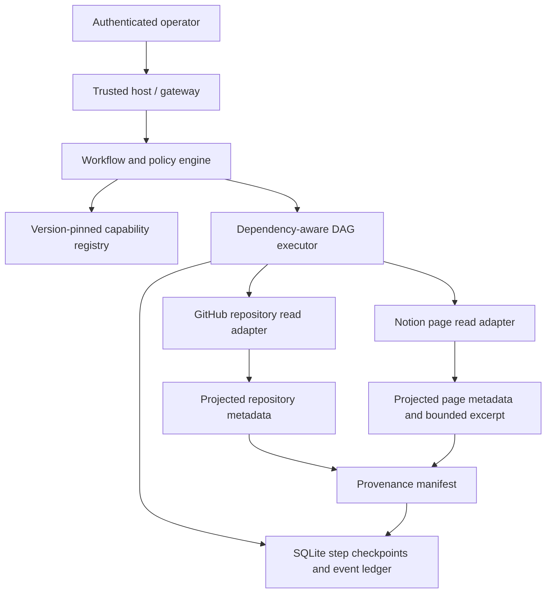

# UPAOI v0.2 architecture — executable read-only integration slice

The trusted host is **not implemented** yet; it must authenticate operators, inject least-privilege secrets, and bind authorization to caller identity before any production use. Read-only credentials are separate from ChatGPT's connected plugin identities.

## Implemented

- Deterministic, pinned read-only capabilities: `github.repository_read`, `notion.page_read`, `local.evidence_manifest`.
- Explicit repository and page allowlists; token required for Notion, optional for public GitHub repository metadata.
- Server-controlled HTTPS endpoints, blocked cross-host redirects, bounded response sizes and timeouts.
- Minimal provider result projection, schema enforcement, event ledger, crash recovery for read operations.
- Independent fixture-based tests for allowlists, API response contracts, data injection boundaries and step checkpointing.
- Latest health inventory recorded as **observations**, not proof of ongoing authorization or API availability.

## Not implemented

- ChatGPT plugin token handoff, authenticated users/tenants, cloud secrets broker, distributed workers, concurrency locks, queues, user approval tokens, hosted UI, live integration monitoring, external writes or PR creation.
- Independent source truth verification: an evidence manifest records provenance links, not validated claims.
- Full recursive Notion page retrieval: page child listing is bounded at 25 blocks and `truncated` signals partial coverage.
- Cryptographically tamper-evident logs and secure encrypted storage; SQLite is a local prototype store.

## Provenance and trust

Outputs from GitHub/Notion are untrusted data. Prompt-like text within source content does not authorize new tools, grants, task changes or policy overrides. The workflow grants are static inputs of a trusted caller. The current engine's idempotency uses a request ID and workflow digest but is **not** a substitute for authenticated requester binding.

## Release gate

Do not deploy this engine with an open execution API. First implement: bearer/session auth at a trusted service boundary, per-tenant resource ACLs, credential vault, bounded execution lock, data retention rules, redaction and approval receipts. Then add a live API smoke test with narrow scopes, mocked failure integration tests and a write-ahead outbox for any external writes.
